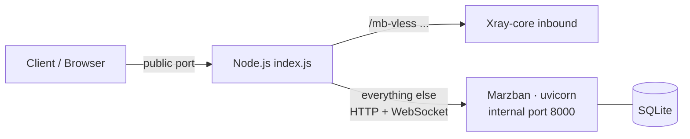

<div align="center">

# 🛰️ Marzban · KataBump Edition

**Run the full [Marzban](https://github.com/Gozargah/Marzban) (Gozargah) panel on a free KataBump container —
two files, no root, no Docker, one public port.**

[](https://nodejs.org)
[](https://github.com/Gozargah/Marzban)
[](https://github.com/XTLS/Xray-core)
[](#)
[](#)
[](#license)

**🌐 Languages:**
[English](#-english) ·
[فارسی](#-فارسی) ·
[Русский](#-русский) ·
[中文](#-中文) ·
[العربية](#-العربية) ·
[Türkçe](#-türkçe)

</div>

---

# 🇬🇧 English

## ✨ What is this?

Marzban is a Python application whose official installer expects **root, Docker and systemd**.
A KataBump container gives you none of that — just an unprivileged box with **one public TCP port**
that runs `node index.js` in the foreground.

This project bridges the gap. Node owns the public port and drives Marzban's Python process as a child process.
**Add it to KataBump and a working Marzban panel is built for you automatically.**

## 🚀 Features

- 📦 **Just two files** — `index.js` + `package.json`. Zero npm dependencies.
- ⚡ **Instant port** — the public port opens immediately and shows a self-refreshing "setting up" page.
- 🐍 **Python handled for you** — uses Python 3.10–3.13 if present, otherwise downloads a portable CPython.
- 📥 **Auto-downloads** the official Marzban release and Xray-core (cached for next boots).
- 🧪 **Persistent virtualenv** with Marzban's own pinned requirements (first boot only).
- 🔐 **Admin created for you** — credentials set from env vars or generated randomly, saved to `PANEL.txt`.
- 🔀 **Single-port multiplexing** — panel (HTTP + WebSocket) and Xray tunnels share one public port.
- ♻️ **Self-healing** — the panel restarts automatically if it ever dies.
- 🪶 **Low-memory tuned** — built for KataBump's small free plan (~308 MB total).
- 🔗 **Correct subscription links** — set `MARZBAN_PUBLIC_HOST` so links don't point at `127.0.0.1`.
- 📊 **Status endpoint** at `/_kb/status` (JSON).

## 🧠 How it works



1. Opens the public port and serves a status page.
2. Finds (or downloads) a usable Python.
3. Downloads Marzban source + Xray-core.
4. Creates a virtualenv and installs requirements.
5. Writes `.env` and a single-port `xray_config.json`, runs migrations, creates the first sudo admin.
6. Starts Marzban on an internal port and routes: tunnel path → Xray, everything else → Marzban.
7. Restarts the panel if it crashes.

## 📥 Quick start (KataBump)

1. Create a server on [KataBump](https://katabump.com) with a **Node.js** image.
2. **Add this project** to the server (upload `index.js` and `package.json`, or point it to this repository).
3. Set the startup command to:
   ```bash
   npm start
   ```
4. *(Recommended)* Set environment variables — at least `ADMIN_USER`, `ADMIN_PASS` and `MARZBAN_PUBLIC_HOST`.
5. Start the server and watch the console. The first boot downloads and installs everything (several minutes).
6. Open the dashboard:
   ```
   http://<your-address>:<port>/dashboard/
   ```
   Credentials are printed in the console and saved in `marzban/PANEL.txt`.

> 💡 First boot is slow; later boots are fast because everything is cached.

## ⚙️ Environment variables

All optional.

| Variable | Default | Description |
|---|---|---|
| `SERVER_PORT` / `PORT` | first free of `8080/3000/8000` | Public port |
| `PANEL_PORT` | `8000` | Internal Marzban port |
| `ADMIN_USER` | `admin` | Panel username |
| `ADMIN_PASS` | random | Panel password |
| `FORCE_ADMIN` | – | `1` = re-apply credentials on an existing database |
| `MARZBAN_PUBLIC_HOST` | – | Host clients use (`host` or `host:port`) for subscription links |
| `MARZBAN_VERSION` | `v0.8.4` | Marzban release tag or branch |
| `XRAY_VERSION` | `latest` | Xray-core tag |
| `XRAY_SUBSCRIPTION_PATH` | `sub` | Subscription URL path |
| `MARZBAN_TUNNELS` | `vless:/mb-vless:21001` | Tunnels, e.g. `vless:/mb-vless:21001,trojan:/mb-trojan:21002` |
| `MARZBAN_SKIP_XRAY` | – | `1` = don't download/run Xray-core |
| `MARZBAN_FORCE_SETUP` | – | `1` = re-download / reinstall everything |
| `MARZBAN_FORCE_HOSTS` | – | `1` = overwrite host settings you edited by hand |
| `MARZBAN_PYTHON` | – | Absolute path to a Python 3.10–3.13 interpreter |
| `MARZBAN_PORTABLE_PY` | – | `1` = always use the downloaded portable CPython |
| `TZ` | `UTC` | Panel timezone |
| `KATABUMP_ROOT` | auto | Data root |
| `SELFTEST` | – | `1` = run self-tests and exit (`npm run selftest`) |

### Tunnel format

```
protocol:/path:internal-port
```

Supported protocols: `vless`, `trojan` (WebSocket) and a TCP fallback. Example:

```
MARZBAN_TUNNELS="vless:/mb-vless:21001,trojan:/mb-trojan:21002"
```

## 📁 Data layout

Everything lives under `marzban/` in your data root:

```
marzban/
├── app/          # Marzban source
├── venv/         # Python virtualenv
├── python/       # portable CPython (only if needed)
├── xray-core/    # Xray binary
├── data/         # db.sqlite3, xray_config.json
├── log/
├── state.json
└── PANEL.txt     # panel credentials
```

> 🔄 **Back up `marzban/data/`** to keep your users and settings.

## 🛠️ Troubleshooting

| Problem | Fix |
|---|---|
| Page says "setting up" for a long time | Normal on first boot. Watch the console. |
| Out of memory | Use `npm start` (it sets `--max-old-space-size=48 --expose-gc`). |
| Subscription links show `127.0.0.1` | Set `MARZBAN_PUBLIC_HOST`. |
| Forgot password | Check `marzban/PANEL.txt`, or set `ADMIN_PASS` + `FORCE_ADMIN=1`. |
| Broken install | Set `MARZBAN_FORCE_SETUP=1` for one boot. |
| No usable Python | Set `MARZBAN_PORTABLE_PY=1` or `MARZBAN_PYTHON=/path/to/python`. |
| Check health | Open `/_kb/status`. |

## 🔒 Security notes

- **Change the default credentials** — set `ADMIN_USER` / `ADMIN_PASS` yourself.
- Don't share `marzban/PANEL.txt`.
- Only the public port is reachable; Marzban and Xray inbounds are internal.
- Use this project only in line with your hosting provider's terms of service and the laws where you live.

## 🤝 Contributing

Issues and pull requests are welcome. Run `npm run selftest` before submitting.

## 🙏 Credits

- [Gozargah/Marzban](https://github.com/Gozargah/Marzban)
- [XTLS/Xray-core](https://github.com/XTLS/Xray-core)
- [python-build-standalone](https://github.com/astral-sh/python-build-standalone)

## 📄 License

MIT — see `LICENSE`.

<div align="right"><a href="#-marzban--katabump-edition">⬆ back to top</a></div>

---

<div dir="rtl" align="right">

# 🇮🇷 فارسی

## ✨ این پروژه چیست؟

مرزبان یک برنامهٔ پایتونی است که نصب رسمی‌اش به **root، داکر و systemd** نیاز دارد.
کانتینر KataBump هیچ‌کدام را نمی‌دهد؛ فقط یک محیط بدون دسترسی ویژه با **یک پورت عمومی** که `node index.js` را اجرا می‌کند.

این پروژه همین مشکل را حل می‌کند: Node پورت عمومی را در اختیار می‌گیرد و پروسهٔ پایتونیِ مرزبان را زیر نظر خودش اجرا می‌کند.
**کافی است آن را در KataBump اضافه کنید؛ پنل کانفیگ مرزبان به‌صورت خودکار ساخته می‌شود.**

## 🚀 امکانات

- 📦 **فقط دو فایل:** `index.js` و `package.json` — بدون هیچ وابستگی npm
- ⚡ **پورت فوراً باز می‌شود** و صفحهٔ «در حال راه‌اندازی» نمایش داده می‌شود
- 🐍 **مدیریت خودکار پایتون:** اگر نسخهٔ ۳.۱۰ تا ۳.۱۳ نبود، نسخهٔ قابل‌حمل دانلود می‌شود
- 📥 **دانلود خودکار** مرزبان و Xray-core (با کش برای اجرای بعدی)
- 🔐 **ساخت خودکار ادمین** — با متغیرهای محیطی یا رمز تصادفی (ذخیره در `PANEL.txt`)
- 🔀 **تک‌پورت:** پنل و تونل‌های Xray روی یک پورت عمومی
- ♻️ **ری‌استارت خودکار** در صورت از کار افتادن پنل
- 🪶 **بهینه برای رم کم** (پلن رایگان حدود ۳۰۸ مگابایت)
- 🔗 **لینک اشتراک درست** با تنظیم `MARZBAN_PUBLIC_HOST`

## 📥 راه‌اندازی سریع

1. در [KataBump](https://katabump.com) یک سرور با ایمیج **Node.js** بسازید.
2. این پروژه را به سرور **اضافه کنید** (آپلود `index.js` و `package.json` یا اتصال به این ریپو).
3. دستور استارت را روی این مقدار بگذارید:
   ```bash
   npm start
   ```
4. *(پیشنهادی)* متغیرهای `ADMIN_USER`، `ADMIN_PASS` و `MARZBAN_PUBLIC_HOST` را تنظیم کنید.
5. سرور را روشن کنید. اولین اجرا چند دقیقه طول می‌کشد (دانلود و نصب).
6. داشبورد را باز کنید:
   ```
   http://<آدرس-شما>:<پورت>/dashboard/
   ```
   نام کاربری و رمز در کنسول چاپ می‌شود و در `marzban/PANEL.txt` ذخیره است.

## ⚙️ متغیرهای مهم

| متغیر | پیش‌فرض | توضیح |
|---|---|---|
| `ADMIN_USER` | `admin` | نام کاربری پنل |
| `ADMIN_PASS` | تصادفی | رمز پنل |
| `MARZBAN_PUBLIC_HOST` | – | آدرسی که کلاینت‌ها می‌بینند (برای لینک اشتراک) |
| `MARZBAN_TUNNELS` | `vless:/mb-vless:21001` | تونل‌ها، مثلاً `vless:/mb-vless:21001,trojan:/mb-trojan:21002` |
| `MARZBAN_VERSION` | `v0.8.4` | نسخهٔ مرزبان |
| `FORCE_ADMIN` | – | مقدار `1` یعنی اعمال دوبارهٔ رمز روی دیتابیس موجود |
| `MARZBAN_FORCE_SETUP` | – | مقدار `1` یعنی نصب مجدد همه‌چیز |

جدول کامل متغیرها در بخش انگلیسی بالا آمده است.

## 🛠️ عیب‌یابی

- **صفحهٔ «در حال راه‌اندازی» طولانی شد:** در اولین اجرا طبیعی است؛ کنسول را ببینید.
- **کمبود رم:** حتماً با `npm start` اجرا کنید.
- **لینک اشتراک با `127.0.0.1` ساخته می‌شود:** `MARZBAN_PUBLIC_HOST` را تنظیم کنید.
- **رمز را فراموش کردید:** فایل `marzban/PANEL.txt` را ببینید یا `ADMIN_PASS` همراه با `FORCE_ADMIN=1` بگذارید.
- **وضعیت سلامت:** آدرس `/_kb/status` را باز کنید.

## 🔒 نکات امنیتی

- حتماً **نام کاربری و رمز را خودتان تعیین کنید**.
- فایل `PANEL.txt` را با کسی به اشتراک نگذارید.
- از `marzban/data/` بکاپ بگیرید.
- استفادهٔ شما باید مطابق قوانین سرویس‌دهندهٔ هاست و قوانین کشورتان باشد.

</div>

<div align="right"><a href="#-marzban--katabump-edition">⬆ back to top</a></div>

---

# 🇷🇺 Русский

## ✨ Что это?

Marzban — Python-приложение, официальный установщик которого требует **root, Docker и systemd**.
Контейнер KataBump этого не даёт: только непривилегированная среда с **одним публичным портом** и запуском `node index.js`.

Этот проект решает проблему: Node занимает публичный порт и управляет Python-процессом Marzban как дочерним.
**Добавьте проект в KataBump — рабочая панель Marzban будет создана автоматически.**

## 🚀 Возможности

- 📦 Всего **два файла**, ноль npm-зависимостей
- ⚡ Порт открывается мгновенно, показывается страница «настройка»
- 🐍 Автоматический поиск Python 3.10–3.13 или загрузка портативного CPython
- 📥 Автозагрузка Marzban и Xray-core с кэшем
- 🔐 Админ создаётся автоматически (данные в `PANEL.txt`)
- 🔀 Панель и туннели Xray на одном порту
- ♻️ Автоперезапуск панели при падении
- 🪶 Оптимизировано под малый объём памяти

## 📥 Быстрый старт

1. Создайте сервер на [KataBump](https://katabump.com) с образом **Node.js**.
2. **Добавьте проект** (загрузите `index.js` и `package.json` или подключите репозиторий).
3. Команда запуска: `npm start`
4. Задайте переменные `ADMIN_USER`, `ADMIN_PASS`, `MARZBAN_PUBLIC_HOST`.
5. Запустите сервер. Первый запуск занимает несколько минут.
6. Откройте `http://<адрес>:<порт>/dashboard/`

Полная таблица переменных — в английском разделе выше.

## 🔒 Безопасность

Задайте собственные логин и пароль, не публикуйте `PANEL.txt`, делайте резервные копии `marzban/data/` и соблюдайте правила хостинга и законы вашей страны.

---

# 🇨🇳 中文

## ✨ 这是什么？

Marzban 是一个 Python 应用，官方安装方式需要 **root、Docker 和 systemd**。
KataBump 容器只提供无特权环境和**一个公开 TCP 端口**，并以 `node index.js` 前台运行。

本项目解决了这个问题：由 Node 占用公开端口，并以子进程方式驱动 Marzban 的 Python 进程。
**在 KataBump 中添加本项目，即可自动生成可用的 Marzban 面板。**

## 🚀 特性

- 📦 仅 **两个文件**，零 npm 依赖
- ⚡ 端口立即开放，显示自动刷新的“正在设置”页面
- 🐍 自动查找 Python 3.10–3.13，没有则下载便携版 CPython
- 📥 自动下载 Marzban 与 Xray-core（带缓存）
- 🔐 自动创建管理员（凭据保存在 `PANEL.txt`）
- 🔀 面板与 Xray 隧道共用单一公开端口
- ♻️ 面板崩溃后自动重启
- 🪶 针对小内存环境优化

## 📥 快速开始

1. 在 [KataBump](https://katabump.com) 创建 **Node.js** 服务器。
2. **添加本项目**（上传 `index.js` 和 `package.json`，或关联本仓库）。
3. 启动命令：`npm start`
4. 设置 `ADMIN_USER`、`ADMIN_PASS`、`MARZBAN_PUBLIC_HOST`。
5. 启动服务器，首次启动需要几分钟。
6. 访问 `http://<地址>:<端口>/dashboard/`

完整环境变量表见上方英文部分。

## 🔒 安全提示

请自行设置账号密码，不要泄露 `PANEL.txt`，定期备份 `marzban/data/`，并遵守托管服务商条款及当地法律。

---

<div dir="rtl" align="right">

# 🇸🇦 العربية

## ✨ ما هذا؟

Marzban تطبيق Python يتطلب مثبّته الرسمي **صلاحيات root وDocker وsystemd**.
حاوية KataBump لا توفر ذلك؛ بل بيئة بلا صلاحيات خاصة مع **منفذ عام واحد** يشغّل `node index.js`.

يحل هذا المشروع المشكلة: يمتلك Node المنفذ العام ويشغّل عملية Python الخاصة بـ Marzban كعملية فرعية.
**أضف المشروع إلى KataBump وسيتم إنشاء لوحة Marzban جاهزة تلقائياً.**

## 🚀 المميزات

- 📦 **ملفان فقط** وبدون أي اعتماديات npm
- ⚡ يُفتح المنفذ فوراً مع صفحة «جارٍ الإعداد»
- 🐍 يبحث عن Python 3.10–3.13 أو ينزّل نسخة محمولة
- 📥 تنزيل تلقائي لـ Marzban وXray-core مع التخزين المؤقت
- 🔐 إنشاء المسؤول تلقائياً (البيانات في `PANEL.txt`)
- 🔀 اللوحة وأنفاق Xray على منفذ عام واحد
- ♻️ إعادة تشغيل تلقائية عند التوقف
- 🪶 محسّن للذاكرة المحدودة

## 📥 البدء السريع

1. أنشئ خادماً على [KataBump](https://katabump.com) بصورة **Node.js**.
2. **أضف المشروع** (ارفع `index.js` و`package.json` أو اربط المستودع).
3. أمر التشغيل: `npm start`
4. اضبط `ADMIN_USER` و`ADMIN_PASS` و`MARZBAN_PUBLIC_HOST`.
5. شغّل الخادم؛ التشغيل الأول يستغرق بضع دقائق.
6. افتح `http://<العنوان>:<المنفذ>/dashboard/`

جدول المتغيرات الكامل في القسم الإنجليزي أعلاه.

## 🔒 الأمان

اختر اسم المستخدم وكلمة المرور بنفسك، لا تشارك `PANEL.txt`، انسخ `marzban/data/` احتياطياً، والتزم بشروط الاستضافة وقوانين بلدك.

</div>

---

# 🇹🇷 Türkçe

## ✨ Bu nedir?

Marzban, resmi kurulumu **root, Docker ve systemd** gerektiren bir Python uygulamasıdır.
KataBump konteyneri bunları vermez; yalnızca **tek bir genel TCP portu** olan ayrıcalıksız bir ortam sunar ve `node index.js` çalıştırır.

Bu proje boşluğu doldurur: Node genel portu üstlenir ve Marzban'ın Python sürecini alt süreç olarak yönetir.
**Projeyi KataBump'a ekleyin; çalışan bir Marzban paneli otomatik olarak oluşturulur.**

## 🚀 Özellikler

- 📦 Yalnızca **iki dosya**, sıfır npm bağımlılığı
- ⚡ Port anında açılır, "kuruluyor" sayfası gösterilir
- 🐍 Python 3.10–3.13 bulunur, yoksa taşınabilir CPython indirilir
- 📥 Marzban ve Xray-core otomatik indirilir (önbellekli)
- 🔐 Yönetici otomatik oluşturulur (bilgiler `PANEL.txt` içinde)
- 🔀 Panel ve Xray tünelleri tek genel portta
- ♻️ Panel çökerse otomatik yeniden başlatma
- 🪶 Düşük bellek için optimize

## 📥 Hızlı başlangıç

1. [KataBump](https://katabump.com) üzerinde **Node.js** imajıyla sunucu oluşturun.
2. **Projeyi ekleyin** (`index.js` ve `package.json` yükleyin veya depoyu bağlayın).
3. Başlatma komutu: `npm start`
4. `ADMIN_USER`, `ADMIN_PASS`, `MARZBAN_PUBLIC_HOST` değişkenlerini ayarlayın.
5. Sunucuyu başlatın; ilk açılış birkaç dakika sürer.
6. `http://<adres>:<port>/dashboard/` adresini açın.

Tam değişken tablosu yukarıdaki İngilizce bölümdedir.

## 🔒 Güvenlik

Kullanıcı adı ve parolayı kendiniz belirleyin, `PANEL.txt` dosyasını paylaşmayın, `marzban/data/` yedeğini alın ve barındırma sağlayıcınızın kurallarına ile yerel yasalara uyun.

---

<div align="center">

**⭐ If this project helps you, give it a star! · اگر مفید بود، یک ستاره بدید!**

</div>
